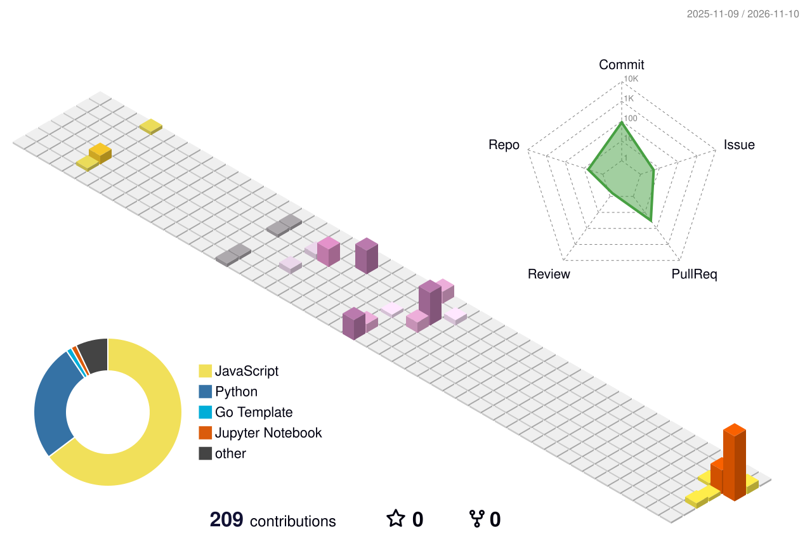

## 👨🏻‍💻 About Me
- 🎓 **Gachon University**
- 💼 **ML Engineer**, building LLM products
- 🤖 Specialized in **LLM Applications**: LangGraph multi-agent pipelines, multi-model streaming, LLM-as-a-judge evaluation
- 🔭 Run **LLM observability & cost tracking** on self-hosted Langfuse (Kubernetes, ClickHouse, v3 → v4 migration in production)
 

## 🛠 Tech Stack

### 💻 Languages
    

### 🤖 LLM & Agent Engineering
     

### 📊 Data
   

### ☁️ Cloud & DevOps
   

 

## 📊 GitHub Stats

  <picture>
    <source media="(prefers-color-scheme: dark)" srcset="https://raw.githubusercontent.com/dongramiho/dongramiho/main/profile-3d-contrib/profile-night-rainbow.svg">
    
  </picture>

 

## 📫 Contact & Links

  
  
  

